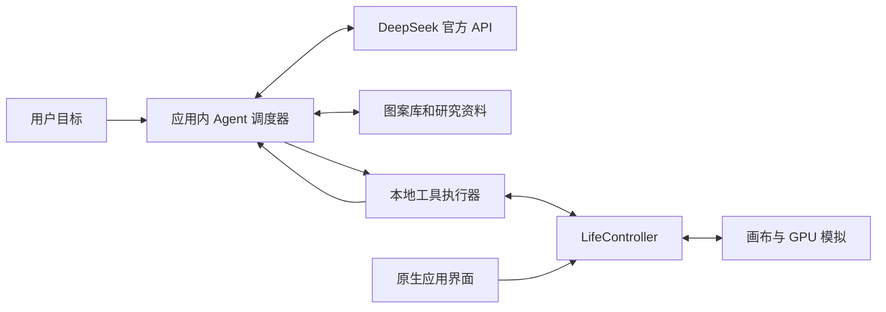

# 生命游戏应用内 AI Agent 设计方案

状态：研究方案，尚未实现。更新日期：2026 年 11 月 17 日。

目标是在 iOS 和 HarmonyOS 应用内接入 Agent，让用户用自然语言查询、设计和修改细胞结构，并由模拟器验证演化结果。Agent 应能够操作应用的全部业务功能，而不仅是回答生命游戏知识问题。第一阶段接入 DeepSeek 官方 API。

研究分支为 `research/ai-agent`，起点是主仓库 1.0.2 合并提交 `baba8d1`。LongMarch 继续使用 `experiment/tiled-gpu-life` 分支的 `a616562b`，不将其合入 LongMarch 主线。本文仅记录方案，不代表以下接口已经存在。

## DeepSeek 接入

截至上述日期，[DeepSeek 官方文档](https://api-docs.deepseek.com/)指定使用模型名 `deepseek-flash`，当前对应 DeepSeek-V4.1-Flash-1017。模型别名的实际版本可能变化，实现时应记录服务端返回的模型信息，重新核实官方能力说明。

- 请求入口：`POST https://api.deepseek.com/chat/completions`。
- 鉴权：`Authorization: Bearer <API Key>`。
- 支持工具调用、流式输出、思考模式和图片输入。
- 简单操作可关闭思考；结构设计、分析和多步实验开启思考。
- 模型只返回工具名称与参数，由应用执行工具并回传结果。

初期研究版建议用户输入自己的 API Key，分别保存在 iOS Keychain 和鸿蒙安全存储中，直接请求官方 API。密钥不进入仓库、日志、对话内容或工具返回值。如果以后由开发者统一承担费用，再引入服务端代理和额度控制；开发者密钥不能内置在安装包中。

工具调用协议要点：

1. 收到完整的工具调用参数并验证后才执行，不能对流式半截 JSON 采取行动。
2. 保留 assistant 的工具调用消息；每条结果使用对应 `tool_call_id` 回传。
3. 开启思考且请求包含工具时，按官方要求保留并回传历史 `reasoning_content`。不要将协议字段误当成用户可编辑的工具指令。
4. 标准入口使用本地 Schema 和语义校验。官方 strict 模式目前属于 Beta，需要 `/beta` 入口及 `strict: true`，不能默认标准入口具有同样保证。
5. 网络重试与工具重试分开处理；不能因请求超时重复修改画布。
6. 限制单次输出、上下文大小、工具轮数和任务费用；记录 API 返回的 usage，价格以官方页面为准。

参考：[工具调用](https://api-docs.deepseek.com/guides/tool_calls)、[思考模式](https://api-docs.deepseek.com/guides/thinking_mode)、[Chat Completions](https://api-docs.deepseek.com/api/create-chat-completion)、[模型与价格](https://api-docs.deepseek.com/quick_start/pricing)。

## 总体架构

建立统一的 `LifeController` 语义接口，让 UI 和 Agent 共享业务操作。Agent 不模拟按钮点击，不直接读写内部变量，也不依赖屏幕尺寸或控件位置。

网络层由 iOS 和鸿蒙各自的原生网络组件适配；工具名称、参数、结果、错误码和操作语义保持一致。命令校验、画布事务及模拟控制尽量放在共享 C++ 层。协议应有版本号与能力查询，避免两端功能不一致时模型调用不存在的工具。

## 工具范围

下表是拟定的工具分组；具体名称和 JSON Schema 在实现阶段确定。

| 能力 | 拟提供操作 |
| --- | --- |
| 状态查询 | 画布尺寸、规则、边界模式、代数、运行状态、速度、视野、选择区域、实验任务进度、可用能力 |
| 细胞查询 | 指定区域的活细胞坐标、RLE、数量、包围盒及分页结果 |
| 布局编辑 | 批量设置活／死状态，清空区域，放置、移动、复制、旋转、镜像结构 |
| 视野操作 | 缩放、平移、定位坐标、适配区域或完整图案 |
| 演化控制 | 开始、暂停、设置速度、精确推进 N 代 |
| 全局操作 | 重置、按密度和种子随机化、切换边界模式 |
| 图案管理 | 搜索内置及用户图案，查看详情，载入、保存、重命名和删除用户图案 |
| 导入导出 | 导入 RLE 与现有存档，导出图案；系统文件选择和分享交给原生界面 |
| 实验分析 | 比较快照，测量数量与包围盒，在限定代数内检测静物、周期或位移 |
| 知识检索 | 检索术语、已知结构、构造教程、引用来源和可下载图案 |
| 任务控制 | 查询进度、取消任务、撤销或恢复一次编辑批次 |

全部业务功能不等于开放系统权限管理。隐私同意、API Key 管理等由用户直接操作；Agent 不能替用户确认系统隐私协议或读取密钥。

### 坐标和状态一致性

- 使用画布中心 `(0,0)`，与现有坐标尺一致；正式协议必须明确轴方向、整数格点和半开区域边界。
- 查询返回 `canvas_revision`、模拟代数及快照标识；编辑携带预期 revision，拒绝基于过期状态的写入。
- 运行中的画布查询需要一致快照。编辑或精确推进应明确暂停、执行和是否恢复播放的语义，不能暗中改变用户运行状态。
- 工具请求带唯一操作 ID，实现幂等去重。编辑采用“设为活／死”，不采用可被重试反转的 Toggle。
- 每个编辑批次原子应用，失败不留下半个布局；返回变更范围和新的 revision。
- 边界之外的坐标默认报错；环绕或裁切必须显式指定。

### 线程和性能

所有 GPU 状态修改在现有渲染线程的安全时点执行。网络、资料检索及模型等待不占用渲染线程。需要 GPU 读取的查询异步等待完成后才报告成功。

当前全画布共有 16384 × 16384 个格点，单纯 bit 数据约 32 MiB；不应每次工具调用都读取或上传整个画布。使用区域查询、统计摘要、分页、RLE 与本地快照句柄，按需读取 GPU 数据。

批量编辑必须更新对应块的边界、活动标记和显示 mip 状态，唤醒受影响邻域，避免修改落在休眠块后不参与下一代计算。精确推进 N 代采用可取消、分批执行的任务，不能用播放持续时间替代代数。

### 错误和取消

工具使用结构化结果和明确错误，例如 `invalid_arguments`、`stale_revision`、`out_of_bounds`、`resource_limit`、`cancelled`、`needs_user_action`。模型可依据错误修正请求，不能把失败描述为成功。

取消应终止后续模型轮次和未执行命令；已提交 GPU 的批次在安全边界结束。保存可撤销的编辑记录，必要时恢复批次前快照。撤销所需内存及存储应有上限。

## 当前代码基础与缺口

可复用的实现：

- `harmonyos/native/Host.h`、`Host.cpp`：JSON 命令入口、队列和独立渲染线程。
- `ios/demos/DemoBridge.h`、`DemoBridge.mm`：原生桥接与 LongMarchRenderQueue。
- 两端 `DesktopGameSession`：宿主操作、存档和原生确认桥接。
- `game/game_of_life_gui.h`：共享应用状态与控制逻辑。
- `game/gpu/tiled_life.h`：GPU 分块演化、休眠块、上传、填充及单格修改。
- `game/patterns/library.json`：736 个内置结构。

主要新增工作：

1. 补齐状态查询和具有明确语义的控制接口，避免暴露 UI 私有成员。
2. 增加区域读取、批量设置细胞和图案变换；现有全量 Upload、Toggle、Fill、Step 不足以构成完整 Agent 工具集。
3. 增加精确推进、实验任务、进度和取消。
4. 增加 revision、原子编辑、幂等操作及撤销记录。
5. 统一两端协议、工具参数验证与错误语义。

这些改动主要属于应用和 `game` 层，初期不需要扩展 RHI 抽象。共享模拟接口属于 App 仓库；LongMarch 仅维护通用 RHI 和平台适配。

## 结构设计工作流

以“设计持续发射滑翔机、最终被吸收的布局”为例：

1. 从图案库检索滑翔机枪和吸收器。
2. 获取精确图案数据，通过旋转、镜像、平移组合。
3. 在独立实验画布中推进有限代数。
4. 检查吸收器是否完整、有没有逸出的滑翔机，并根据结果调整。
5. 应用已验证的候选布局，定位视野并开始展示。

复杂图案使用结构 ID、位置和变换参数，不让模型逐格输出大量坐标。需要原创结构时才使用 RLE 或局部编辑。模型负责提出候选和解释，模拟器负责提供可重复的实测结果。

同时支持用户可见的当前画布操作和隔离的实验画布。周期检测必须注明观察代数、边界模式和检测方法；有限时间内未发生变化不是永久稳定的证明，也不能把单个区域的检测结果泛化到整个世界。

## 知识库

只把链接写进提示词不够，Agent 需要能够检索相关正文和图案。

### 本地资料

以现有 736 个图案为起点，补充中文别名、关键词、类别、尺寸、周期、速度、RLE、来源和授权信息。先采用关键词和标签检索；资料规模增大后再评估向量检索。

### 研究资料入口

| 来源 | 用途 |
| --- | --- |
| [LifeWiki](https://conwaylife.com/wiki/Main_Page) | 术语、结构、构造方法及研究背景 |
| [Life Lexicon](https://github.com/dvgrn/life-lexicon) | 对应现有图案库的定义和资料 |
| [Golly](https://golly.sourceforge.io/) | 大型结构、实验案例和 HashLife 相关资料 |
| [Golly 的 metacell 示例](https://github.com/AlephAlpha/golly/tree/master/Patterns/HashLife/Metacell) | 元细胞与大型构造的实例 |
| [Catagolue](https://catagolue.hatsya.com/) | 已知对象分类和合成资料 |
| [OTCA metapixel](https://conwaylife.com/wiki/OTCA_metapixel) | 用生命游戏模拟元胞自动机的专题 |
| [0E0P metacell](https://conwaylife.com/wiki/0E0P_metacell) | 元细胞构造专题 |

LifeWiki 在本次自动访问中返回 HTTP 403，不能依赖实时抓取始终可用。应准备授权允许的离线资料、人工整理内容或其他来源。Golly 网站和仓库中的 metacell 示例已确认存在。

每项资料保留标题、URL、获取日期、作者和许可证；离线复制应逐项核实授权，不能因为公开可访问就默认可以整站再分发。网页正文作为知识数据处理，不允许网页指令改变工具权限或执行范围。

当前画布并非真正无限。大型元细胞可能超出 16384 × 16384 范围，或需要极多底层代数才能推进一次宏观状态。后续需要单独评估 Macrocell 格式支持和 HashLife 实验后端；第一阶段可以提供讲解、来源和容量内演示，不承诺所有大型构造都能在现有 GPU 路径上流畅运行。

## 应用交互与隐私

提供原生聊天面板、任务进度、可展开的操作记录和随时取消。Agent 在用户授权的任务内连续操作，不逐格弹确认；重置、覆盖及删除已有内容沿用确认流程，并尽量提供整体撤销。

首次启用联网助手时说明会发送给 DeepSeek 的内容：用户消息、选定区域数据、必要状态及主动提供的图片。默认不上传完整存档或全画布，工具结果按需裁剪。更新应用隐私声明和商店数据披露，保留不启用 Agent 时的本地模拟能力。

## 分阶段实施与验收

### 第一阶段 可用研究版本

- 聊天面板、Key 安全存储、DeepSeek 流式工具调用与取消。
- 状态和区域查询、图案搜索与放置、批量编辑。
- 缩放、平移、播放、暂停、调速和精确推进。
- 重置、随机化、操作记录及整批撤销。
- 本地知识检索、来源链接及任务预算限制。

验收目标是完成“找到结构 → 放入画布 → 实测演化 → 展示结果”的完整闭环。相同工具请求在 iOS 和鸿蒙产生相同业务结果。

### 第二阶段 研究实验

- 独立实验画布、多候选对照、周期与位移检测。
- 完整的用户图案管理、导入导出与知识资料读取。
- 扩展资料索引，记录实验参数和可复现步骤。

### 第三阶段 大型构造

评估 Macrocell、HashLife 和大型元细胞实例；根据真实容量与性能测试决定支持范围，而非直接扩展模型提示词。

### 重点测试

- 全部工具的参数校验、错误结果和两端协议一致性。
- 重试去重、revision 冲突、用户与 Agent 同时操作。
- 编辑跨块边界、唤醒休眠块、精确代数与边界模式。
- 批次撤销、取消、后台切换、设备旋转及进程重启。
- API 流式中断、认证失败、限流、超时及预算耗尽。
- 网页指令注入、超大 RLE、越界输入及受限解压。
- 确认对话框、文件选择取消和隐私撤回后不继续执行任务。

## 后续决策

初期采用用户自带 Key、共享语义工具层和本地图案检索。具体工具 Schema、实验画布资源上限、单任务预算以及正式版是否引入服务端代理，在实现前确定。当前只保存设计方案，不开始功能实现。
